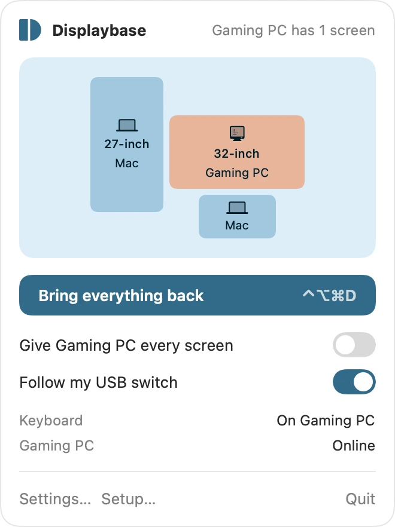

<p>
  <picture>
    <source media="(prefers-color-scheme: dark)" srcset="brand/displaybase-logo-dark.svg">
    
  </picture>
</p>

**One desk, two computers.** Displaybase is a Mac menu bar app that hands a monitor to your other computer, tidies your Mac onto the screen it keeps, and puts everything back when you're done.

[displaybase.radsoft.tech](https://displaybase.radsoft.tech)

[](https://github.com/Rad-Soft/displaybase/actions/workflows/ci.yml)

<picture>
  <source media="(prefers-color-scheme: dark)" srcset="site/public/shots/menu-pc-dark.webp">
  
</picture>

## Why

I work on a MacBook and play on a gaming PC. They share two monitors, and a USB switch moves my keyboard between them. Nothing moved the screens.

When a monitor did switch, macOS didn't know it was gone. Windows stayed on a screen I couldn't see, the layout reshuffled, and my portrait monitor came up sideways. And if I needed the Mac for a second, I didn't want that to end my game.

So I wanted one press: the PC on the main screen, the Mac tucked onto the side one, and everything back where it was afterwards. That's Displaybase.

Geeth

## Install

```sh
brew install --cask rad-soft/tap/displaybase
```

Or build it:

```sh
git clone https://github.com/Rad-Soft/displaybase
cd displaybase
brew install xcodegen
make install
```

That build is signed on your own Mac, so macOS asks for Accessibility again each time you rebuild. To use your own certificate, put it in `Config/Local.xcconfig`:

```
DISPLAYBASE_TEAM = YOURTEAMID
DISPLAYBASE_IDENTITY = Apple Development
```

## What it does

Press the shortcut, the menu button or the button on your USB switch, and Displaybase:

1. Switches the monitor to your other computer's input.
2. Turns that screen off in macOS, so windows and the pointer can't wander onto it.
3. Moves the menu bar to the screen the Mac keeps, and holds that screen's rotation.

Do it again and it switches the input back, restores the layout, and puts your windows where they were.

Screens can always go, stay, or go only when you choose to give the other computer every screen.

### With a USB switch

Pick something that's always plugged into the switch, like the keyboard. When it leaves the Mac, the screens follow. When it comes back, you can have everything return, or only borrow the keyboard and leave the other computer its screen.

### With SSH

This part is optional. If the other computer accepts SSH, Displaybase asks whether the keyboard really landed there before giving a screen away, and takes the screens back if that computer goes offline. It uses your own `~/.ssh/config` and keys. Windows, Linux and macOS work.

### From a script

```sh
# turn on "Allow displaybase:// links" in Settings first
open displaybase://pc
open displaybase://mac
open displaybase://toggle
```

## What you need

- A Mac with Apple silicon, on macOS 15 or later
- Monitors with DDC/CI turned on, plugged into both computers

It won't work with Intel Macs, DisplayLink docks and adapters, or some LG monitors, which ignore the standard input command. Two matching monitors that report the same serial number can't be told apart.

It's early, and so far it has been used on one desk. See [the monitors it's been tried on](docs/monitors.md) and [add yours](https://github.com/Rad-Soft/displaybase/issues/new?template=monitor.yml).

## Permissions

| macOS asks about | When | Why |
| --- | --- | --- |
| Accessibility | Optional | To put windows back where they were |
| Notifications | Optional | To warn you if your USB switch goes missing |
| Local network | Only if you set up SSH | To check on your other computer |
| Open at login | Optional | So it's there when you sit down |

It never records your screen or what you type. There's no account and no analytics. Apart from your own computer over SSH, the only thing it contacts is its update feed.

## How it works

Input switching is DDC/CI, through the same Apple silicon display services other monitor apps use. Turning a screen off and setting rotation go through private macOS APIs, because there aren't public ones. A macOS update could break them, and they're why this can't be on the App Store.

## Contributing

See [CONTRIBUTING.md](CONTRIBUTING.md). Report security problems [privately](SECURITY.md).

## License

[MIT](LICENSE). The Displaybase name and logo aren't part of it.
